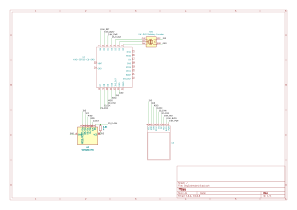
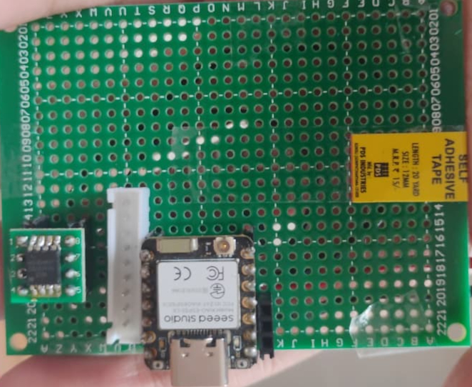
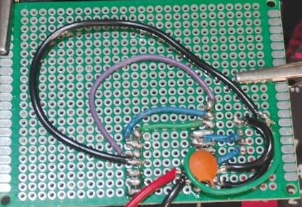

# Org-Calendar
Repo Containing All Details about my Emacs Orgmode based Calendar using E-ink display
## Hardware

### Schematic

### Top

### Bottom

# Note: Claude is only used in docs, not used in code, I am having fun writing this so I do not plan to use it.
